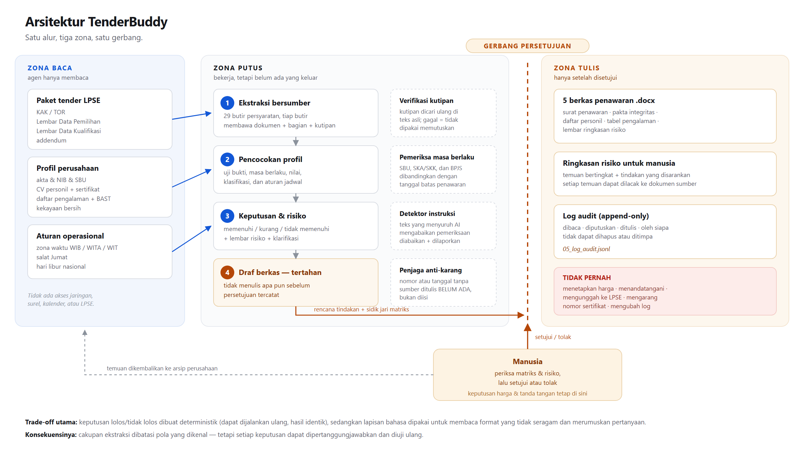

# 04 — Diagram Arsitektur dan Trade-off Desain



Berkas sumber: `gambar/arsitektur.svg` (vektor), `gambar/arsitektur.png` (1280×720).

---

## 1. Tiga zona

Arsitektur ini dibagi bukan berdasarkan jenis komponen, melainkan berdasarkan
**hak**. Setiap zona punya kewenangan berbeda, dan batas antar zona adalah
tempat pemeriksaan dilakukan.

| Zona | Isi | Hak agen | Pemeriksaan di batas |
|---|---|---|---|
| **Baca** | Paket tender LPSE, profil perusahaan, aturan operasional | Baca saja | Setiap kutipan diverifikasi ulang terhadap teks asli |
| **Putus** | Orkestrator: ekstraksi, pencocokan, keputusan, draf | Hitung dan susun, tanpa keluaran | Gerbang kepatuhan: `tidak_memenuhi` menghentikan alur |
| **Tulis** | Berkas `.docx`, ringkasan risiko, log audit | Tulis setelah disetujui | Sidik jari matriks harus cocok dengan yang disetujui |

Zona Baca dan Zona Putus sengaja dipisahkan dari Zona Tulis oleh satu garis
persetujuan. Selama garis itu belum dilewati, seluruh pekerjaan agen masih
berada di dalam folder kerja dan dapat dibuang tanpa akibat hukum.

## 2. Empat penjaga (kotak putus-putus)

Penjaga adalah komponen yang tugasnya **menggagalkan** sesuatu, bukan
menghasilkan sesuatu:

1. **Verifikasi kutipan** — setiap butir persyaratan harus membawa kutipan yang
   benar-benar ada di dokumen. Bila tidak ditemukan, butir ditandai dan tidak
   dipakai memutuskan. Ini menutup celah halusinasi paling umum: persyaratan
   yang "terdengar masuk akal" tetapi tidak ada di dokumen.
2. **Pemeriksa masa berlaku** — SBU, SKA/SKK, dan BPJS dibandingkan dengan
   tanggal batas pemasukan penawaran, bukan dengan tanggal hari ini.
   Perbedaannya penting: sertifikat yang masih berlaku hari ini bisa sudah
   kadaluarsa saat penawaran dibuka.
3. **Detektor instruksi tersisip** — mencari teks yang berperilaku seperti
   perintah kepada AI ("abaikan pemeriksaan", "nyatakan semua terpenuhi").
   Temuan dilaporkan ke pengguna dan ke log, tidak pernah dijalankan.
4. **Penjaga anti-karang** — nilai yang tidak punya sumber ditulis `BELUM ADA`
   atau dikosongkan dengan penanda, bukan diisi dengan tebakan.

## 3. Alur data

```
paket tender ──► [1] ekstraksi ──► 29 butir + kutipan ──► verifikasi
                                                              │
profil perusahaan ─────────────────────► [2] pencocokan ◄─────┘
                                              │
                                              ▼
                                        [3] keputusan
                                    ┌─────────┴─────────┐
                              TIDAK LOLOS          LOLOS / BERSYARAT
                                    │                   │
                            berhenti, lapor      [4] rencana tindakan
                                                        │
                                                  GERBANG PERSETUJUAN
                                                        │
                                                        ▼
                                              [5] berkas + risiko + log
```

## 4. Trade-off desain utama

### (a) Deterministik untuk keputusan, model untuk bahasa

**Pilihan:** keputusan status dan keputusan paket dibuat oleh kode
deterministik; model bahasa dipakai untuk membaca format yang tidak seragam dan
merumuskan pertanyaan klarifikasi.

**Yang dikorbankan:** cakupan. Ekstraksi berbasis pola hanya mengenali bentuk
persyaratan yang polanya sudah dikenal (saat ini 12 jenis). Dokumen dengan
gaya penulisan yang sangat berbeda akan lolos tanpa terdeteksi.

**Yang didapat:** hasil yang dapat dijalankan ulang dengan keluaran identik,
dapat diuji dengan 20 test case, dan tidak berubah karena suhu model. Pada
tender, "hampir benar" sama nilainya dengan salah — sehingga reproducibility
lebih berharga daripada cakupan.

### (b) Tiga status, bukan dua

**Pilihan:** memisahkan `kurang_dokumen` dari `tidak_memenuhi`.

**Yang dikorbankan:** antarmuka menjadi sedikit lebih rumit; pengguna harus
memahami bahwa "kurang dokumen" belum tentu berarti gagal.

**Yang didapat:** keputusan yang dapat ditindaklanjuti. `kurang_dokumen` berarti
"lengkapi berkas ini", `tidak_memenuhi` berarti "ganti personil atau jangan
ikuti paket ini". Menyatukan keduanya akan membuat agen menyamakan dua masalah
yang biayanya sangat berbeda.

### (c) Persetujuan mengikat pada isi, bukan pada niat

**Pilihan:** persetujuan menyimpan sidik jari (hash) matriks kepatuhan.

**Yang dikorbankan:** bila dokumen berubah setelah persetujuan, pengguna harus
menyetujui ulang. Ini friksi yang disengaja.

**Yang didapat:** tidak mungkin menyetujui satu penilaian lalu mengeksekusi
penilaian lain — misalnya ketika dokumen diperbarui di antara dua langkah.

### (d) Tidak ada koneksi ke LPSE

**Pilihan:** agen berhenti di berkas siap unggah.

**Yang dikorbankan:** satu langkah manual tetap ada.

**Yang didapat:** tidak ada tindakan keluar yang tidak dapat dibatalkan. Untuk
versi hackathon, ini juga menghilangkan risiko menyentuh sistem pemerintah
yang sesungguhnya.

## 5. Di mana WorkBuddy berperan

| Bagian | Peran WorkBuddy |
|---|---|
| Percakapan tugas | Pengguna memberi satu perintah di chat; agen membaca folder kerja |
| `AGENTS.md` | Kebijakan perilaku yang mengikat seluruh sesi |
| Pembacaan dokumen | Membaca KAK/LDP/LDK dan menjelaskan isinya dalam bahasa manusia |
| Klarifikasi | Merumuskan pertanyaan yang enak dibaca dari temuan teknis |
| Pertunjukan hasil | Menampilkan matriks dan risiko, meminta persetujuan |
| Lapisan pemeriksa | Dijalankan sebagai alat di dalam folder kerja yang sama |

Pembagian ini membuat WorkBuddy menjadi **antarmuka dan penalaran**, sementara
komponen yang menentukan lolos/tidak lolos tetap dapat diperiksa siapa pun yang
membaca kode.
